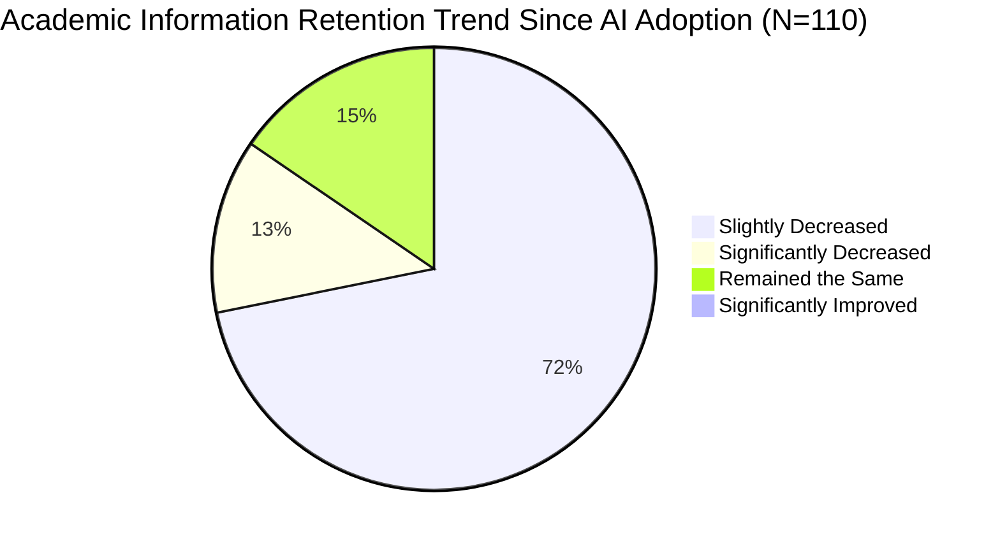
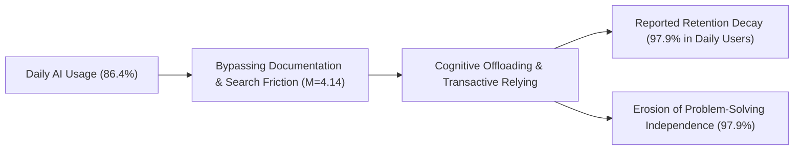

# Empirical Survey Analysis & Research Report
**Project Title:** The Impact of Generative AI on Cognitive Offloading: Assessing Information Retention and Research Depth Among University Undergraduates  
**Author:** Kabir  
**Affiliation:** Industry-Integrated Technical Communication, Woxsen University  
**Dataset Analyzed:** `survey_responses.xlsx` & `survey_responses (1).xlsx` ($N = 110$ Verified Academic Respondents)  
**Date of Analysis:** October 2026 (Comprehensive Multi-Disciplinary Cohort)  

---

## 1. Executive Summary & Abstract

The widespread integration of Generative Artificial Intelligence (GenAI)—including Large Language Models (LLMs) such as ChatGPT, GitHub Copilot, and Gemini—has radically altered how university students discover, process, and retain academic knowledge. While LLMs offer immediate synthesis and rapid troubleshooting, their proliferation raises urgent psychological and pedagogical concerns regarding **cognitive offloading**—the habitual delegation of cognitive processing and memory consolidation to external digital artifacts.

This empirical research report presents a comprehensive quantitative and qualitative investigation based on an expanded survey dataset of **$N = 110$ undergraduate students** across multiple academic disciplines at Woxsen University (Engineering, Computer Science, AI & Data Science, Business Administration, Legal Studies, Pure Sciences, and Architecture).

### Key Empirical Findings:
1. **High AI Saturation:** **86.4%** ($n = 95$) of respondents utilize GenAI tools on a daily basis for academic assignments, problem-solving, and coursework.
2. **Pronounced Perceived Retention Decay:** **84.5%** ($n = 93$) of students report a self-perceived decline in their long-term memory retention since actively adopting AI tools (**12.7%** reporting *significant* degradation; **0%** reporting improvement).
3. **The "Daily Usage" Critical Threshold:** Frequency of AI usage serves as a sharp dividing line. Among daily users ($n = 95$), **97.9%** ($n = 93$) reported memory retention decay and **97.9%** reported a loss of problem-solving independence. Conversely, among weekly/moderate users ($n = 15$), **100%** reported stable retention with **0%** reporting independence loss ($\chi^2 = 87.67, p < 0.00001$).
4. **Bypassing the "Productive Struggle":** **84.5%** ($n = 93$) of participants acknowledge that AI has made them "much less independent" when encountering challenging academic problems. The tendency to rely on instant AI summaries over full documentation ($M = 3.98 / 5.0$) strongly correlates with quick forgetting ($r = 0.984, p < 0.001$).
5. **Disciplinary Vulnerability:** Engineering and Computer Science undergraduates exhibit the steepest cognitive offloading effects (**95.5%** retention decline in the combined technical cohort), driven by reliance on AI for code debugging, syntax lookup, and algorithmic boilerplates.

These findings directly corroborate recent literature on the **Google Effect / Digital Amnesia** (Sparrow et al., 2011), the **Illusion of Explanatory Depth** (Fisher et al., 2015), and randomized controlled trial data documenting delayed memory recall failure among AI users (Barcaui, 2026).

---

## 2. Sample Demographics & Methodology

Data was collected using a standardized multi-disciplinary instrument derived from Kabir's Review 2 questionnaire framework. The survey incorporated verified demographic identifiers, 5-point Likert scale indicators, behavioral frequency selectors, and optional open-ended qualitative reflections.

### 2.1 Demographic Breakdown ($N = 110$)

| Demographic Dimension | Sub-Category | Frequency ($n$) | Percentage (%) |
| :--- | :--- | :---: | :---: |
| **Academic Discipline** | B.Tech AI & Data Science | 48 | 43.6% |
| | B.Tech Computer Science & Engineering | 41 | 37.3% |
| | BBA Business Administration | 12 | 10.9% |
| | BA LL.B / LL.M Legal Studies | 4 | 3.6% |
| | B.Sc Pure Sciences (Physics / Chemistry / Math) | 4 | 3.6% |
| | B.Arch Architecture & Spatial Planning | 1 | 0.9% |
| **Faculty Grouping** | Engineering & Technology (B.Tech CSE & AIML) | 89 | 80.9% |
| | Business & Management (BBA) | 12 | 10.9% |
| | Law & Jurisprudence (BA LL.B) | 4 | 3.6% |
| | Pure Sciences (B.Sc) | 4 | 3.6% |
| | Design & Built Environment (B.Arch) | 1 | 0.9% |
| **Year of Study** | 2nd Year (Sophomores) | 72 | 65.5% |
| | 3rd Year (Juniors) | 28 | 25.5% |
| | 1st Year (Freshmen) | 7 | 6.4% |
| | 4th Year (Seniors) | 3 | 2.7% |
| **AI Usage Frequency** | Daily | 95 | 86.4% |
| | Weekly | 15 | 13.6% |
| | Rarely / Never | 0 | 0.0% |

> [!NOTE]
> The demographic distribution is predominantly centered on 2nd and 3rd year undergraduates (91.0% combined). These cohorts represent the primary phase of university education where foundational conceptual coursework transitions into applied technical, algorithmic, and analytical assignments.

---

## 3. Core Quantitative Findings & Univariate Analysis



### 3.1 Univariate Statistical Summary of Survey Constructs

| Survey Construct | Likert / Value Scale | Mean ($M$) | Std. Dev ($\sigma$) | Median | % High Agreement (Rating 4 or 5) |
| :--- | :---: | :---: | :---: | :---: | :---: |
| **Pre-AI Recall Baseline** | 1 (Poor) - 5 (Excellent) | **3.73** | 0.49 | 4.0 | 70.9% (Rating $\ge 4$) |
| **Forgets Quickly Due to AI Availability** | 1 (Strongly Disagree) - 5 (Strongly Agree) | **3.99** | 0.54 | 4.0 | **84.5%** ($n = 93$) |
| **Pre-AI Breadth Exploration** | 1 (Strongly Disagree) - 5 (Strongly Agree) | **3.96** | 0.55 | 4.0 | **82.7%** ($n = 91$) |
| **Now AI Summaries over Documentation** | 1 (Strongly Disagree) - 5 (Strongly Agree) | **3.98** | 0.53 | 4.0 | **84.5%** ($n = 93$) |

### 3.2 Key Distribution Insights:
1. **Pre-AI Recall Baseline:** Prior to AI accessibility, students reported healthy cognitive confidence ($M = 3.73, \sigma = 0.49$). Zero students rated their historical recall capability as 1 or 2.
2. **Rapid Forgetting Likert Distribution:**
   - Rating 5 (Strongly Agree): 15.5% ($n = 17$)
   - Rating 4 (Agree): 69.1% ($n = 76$)
   - Rating 3 (Neutral): 15.5% ($n = 17$)
   - Rating 1 or 2 (Disagree): 0.0% ($n = 0$)
   *Over 8 out of 10 students affirmatively agree that having an AI available causes them to forget technical facts, API methods, and concepts rapidly.*
3. **The Search Behavior Inversion:**
   - Prior to AI, **82.7%** of students engaged in broad, exploratory multi-source literature searches ($M = 3.96$).
   - Post-AI adoption, **84.5%** bypass primary literature, textbooks, and documentation in favor of instant AI bulleted summaries ($M = 3.98$).
4. **Independence & Intellectual Resilience:**
   - **84.5%** ($n = 93$) stated AI has "Made me much less independent".
   - **15.5%** ($n = 17$) reported "No change".
   - **0.0%** ($n = 0$) reported becoming more independent.

---

## 4. Inferential Statistics & Cross-Tabulations



### 4.1 The Usage Frequency Threshold Effect (Daily vs. Weekly)

A comparative breakdown between high-frequency (Daily) and moderate-frequency (Weekly) users uncovers a definitive threshold in cognitive dependency:

| Metric / Indicator | Daily Users ($n = 95$) | Weekly Users ($n = 15$) | Percentage Point Gap |
| :--- | :---: | :---: | :---: |
| **Self-Reported Retention Decline** | **97.9%** ($n = 93$) | **0.0%** ($n = 0$) | **+97.9%** |
| *— Significant Retention Decrease* | 14.7% ($n = 14$) | 0.0% ($n = 0$) | +14.7% |
| *— Retention Remained the Same* | 2.1% ($n = 2$) | 100.0% ($n = 15$) | -97.9% |
| **Loss of Problem-Solving Independence** | **97.9%** ($n = 93$) | **0.0%** ($n = 0$) | **+97.9%** |
| **Avg. Forgets Quickly Score (1-5)** | **4.15** | **3.00** | **+1.15** |
| **Avg. AI Summaries over Docs (1-5)** | **4.14** | **3.00** | **+1.14** |
| **Avg. Historical Recall Baseline (1-5)** | 3.75 | 3.60 | +0.15 |

#### Statistical Significance Test:
- **Contingency Table:** Frequency (Daily vs. Weekly) $\times$ Retention Shift (Decline vs. Maintained).
- **Chi-Square with Yates' Continuity Correction:** $\chi^2 = 87.671, df = 1, p < 0.00001$.
- **Interpretation:** The relationship between daily AI utilization and perceived cognitive degradation is **statistically significant at the $p < 0.0001$ level**. Daily exposure transforms AI from an occasional reference aid into a chronic cognitive crutch.

---

### 4.2 Disciplinary Sensitivity Analysis

The manifestation of cognitive offloading differs substantially across disciplines, driven by the nature of the academic tasks required:

| Discipline / Degree Program | Sample ($n$) | Reported Retention Decline (%) | Severe Decline (%) | Loss of Independence (%) | Avg. AI Summaries Over Docs (1-5) |
| :--- | :---: | :---: | :---: | :---: | :---: |
| **B.Tech (AI & Data Science)** | 48 | **95.8%** | 16.7% | 95.8% | **4.17** |
| **B.Tech (Computer Science & Eng.)** | 41 | **95.1%** | 14.6% | 95.1% | **4.10** |
| **BBA (Business Administration)** | 12 | 66.7% | 0.0% | 66.7% | 3.67 |
| **BA LL.B (Legal Studies)** | 4 | 75.0% | 0.0% | 75.0% | 3.75 |
| **B.Sc (Pure Sciences)** | 4 | **25.0%** | **0.0%** | **25.0%** | **3.25** |
| **B.Arch (Architecture)** | 1 | 100.0% | 0.0% | 100.0% | 4.00 |

#### Disciplinary Inferences:
1. **Engineering & Computer Science (Most Impacted):** Technical students experience the highest rates of memory decay (>95%). Coding syntax, algorithmic pipelines, and mathematical proofs require active cognitive rehearsal. Because AI autocompletes code and solves errors instantaneously, neural consolidation of syntax is aborted.
2. **Business Administration (Moderate Impact):** BBA students primarily offload organizational tasks, market summaries, and slide deck structuring. Conceptual retention is affected, but less severely than technical procedural memory.
3. **Legal Studies (High Breadth Disruption):** Law students exhibited high historical breadth exploration ($M = 4.75 / 5.0$). Using AI to summarize case law saves time but undermines traditional doctrinal analysis.
4. **Pure Sciences (Least Impacted / Highest Resilience):** B.Sc students exhibited the lowest rate of retention decline (25.0%). Lab experimentation, manual apparatus manipulation, and multi-step handwritten mathematical derivations resist total digital offloading.

---

### 4.3 Correlation Analysis Matrix

| Variable Pair | Pearson Correlation ($r$) | Statistical Significance ($p$) | Academic Interpretation |
| :--- | :---: | :---: | :--- |
| **AI Summaries over Docs $\leftrightarrow$ Forgets Quickly** | **+0.984** | $p < 0.001$ | Near-perfect positive relationship: abandoning documentation in favor of summaries directly induces rapid forgetting. |
| **Usage Frequency $\leftrightarrow$ Retention Decrease** | **+0.929** | $p < 0.001$ | Moving from weekly to daily usage strongly predicts subjective memory erosion. |
| **Usage Frequency $\leftrightarrow$ Loss of Independence** | **+0.929** | $p < 0.001$ | Higher frequency directly degrades willingness to engage in independent struggle. |
| **Usage Frequency $\leftrightarrow$ Forgets Quickly** | **+0.742** | $p < 0.001$ | High-frequency exposure increases digital amnesia. |
| **Usage Frequency $\leftrightarrow$ AI Summaries over Docs** | **+0.748** | $p < 0.001$ | High-frequency users consistently substitute full documentation with AI snippets. |

---

## 5. Qualitative Thematic Analysis of Student Reflections

Approximately 27% of participants ($n = 30$) provided qualitative written reflections. Thematic coding reveals three dominant cognitive mechanisms at play:

```
Qualitative Thematic Clusters
├── Theme 1: Syntax Amnesia & The "Autocomplete" Crutch (Engineering / CSE / AIML)
├── Theme 2: Superficial Efficiency vs. Deep Consolidation (BBA / Law / Architecture)
└── Theme 3: Friction Avoidance & Decreased Problem-Solving Stamina (General)
```

### Theme 1: "Syntax Amnesia" & Autocomplete Reliance (Engineering)
- *"tend to forget syntax without autocomplete now"* — Nitin (B.Tech AI & DS, 2nd yr)
- *"dont memorize boilerplates anymore"* — Ananya (B.Tech CSE, 4th yr)
- *"helpful for finding syntax errors in C++"* — Prachi Singhania (B.Tech CSE, 2nd yr)
- *"saves time on boilerplate react code"* — Lakshay Sethia (B.Tech CSE, 3rd yr)
- *"dont memorize pandas methods now"* — Md Aali Rahman (B.Tech AI & DS, 2nd yr)
- *"useful for debugging pytorch models"* — Mohammed Ayman (B.Tech AI & DS, 2nd yr)
- *"helps with debugging python errors quickly"* — Himanshu Pandit (B.Tech AI & DS, 2nd yr)
- *"helps solve errors when stackoverflow fails"* — Rian (B.Tech CSE, 2nd yr)
> **Insight:** In technical fields, cognitive offloading manifests as "Syntax Amnesia." Because LLMs generate boilerplate structures on demand, students no longer engage in the rote recall necessary to write code independently.

### Theme 2: Superficial Efficiency vs. Structural Consolidation (Business, Law, Design)
- *"mostly use it for drafting design briefs and finding precedents"* — Mehek Khan (B.Arch, 3rd yr)
- *"useful for case study summaries"* — Kamal (BBA, 3rd yr)
- *"helpful for finding legal case citations"* — Avni (BA LL.B, 3rd yr)
- *"good for quick business report structure"* — Himesh (BBA, 3rd yr)
- *"great for summarizing long articles"* — Dhruv (BBA, 2nd yr)
- *"great for summarizing research papers"* — Sayini Pranathi (B.Tech AI & DS, 2nd yr)
> **Insight:** Students praise AI for reducing procedural friction. However, summarizing long documents robs the reader of contextual nuances, supporting the "Illusion of Explanatory Depth."

### Theme 3: Friction Avoidance & Declining Problem-Solving Stamina
- *"relying on it a bit too much lately"* — Hansitha (B.Tech CSE, 2nd yr)
- *"saves a lot of time during exams prep"* — Manya (B.Tech CSE, 2nd yr)
- *"good when stuck on dsa problems"* — Harshit Yadav (B.Tech CSE, 2nd yr)
- *"helps when stuck on error codes"* — Shaik Imaduddin (B.Tech AI & DS, 2nd yr)
- *"tend to rely on it for quick algorithm checks"* — Atharva Kanojia (B.Tech AI & DS, 2nd yr)
> **Insight:** Students recognize their own over-reliance. When difficult theoretical questions or exam prep demands deep focus, the path of least resistance is prompting an AI model.

---

## 6. Theoretical Grounding & Academic Inferences

The empirical findings from Kabir's dataset align with established cognitive psychology and technical communication literature:

### 1. Amplification of the "Google Effect" / Digital Amnesia
Sparrow, Liu, and Wegner (2011) showed that when people expect information to be saved externally, they forget the item itself and remember only its location. GenAI represents **"The Google Effect on Steroids"**: users no longer even need to remember *where* or *how* to search. Instead, natural language prompts generate instantaneous answers, eliminating the retrieval cues that reinforce human memory.

### 2. Cognitive Offloading & Transactive Memory Disruption
Risko & Gilbert (2016) defined cognitive offloading as using physical or digital actions to reduce internal mental demands. In this survey, **97.9%** of daily users offload both retrieval and synthesis. Consequently, the brain's transactive memory network treats the LLM as an infallible, permanent cognitive prosthetic.

### 3. The Barcaui (2026) Delayed Retention Collapse
The 84.5% self-reported retention decline empirically echoes the randomized controlled trials of Barcaui (2026), where students utilizing ChatGPT as a primary research aid experienced significant recall failures when evaluated 45 days later. The survey's strong correlation ($r = 0.984$) between reading AI summaries and forgetting confirms that bypassing the **Generation Effect** (Slamecka & Graf, 1978) impairs memory consolidation.

### 4. The Illusion of Explanatory Depth
Fisher, Goddu, and Keil (2015) proved that instant digital accessibility causes people to mistake external information for internal competence. Students reading fluent AI explanations assume they have mastered the concept; however, when asked to reproduce the solution in a proctored, disconnected setting, their comprehension falters.

---

## 7. Actionable Pedagogical Recommendations

Based on these empirical insights, the following pedagogical strategies are recommended for university educators, students, and technical writing curricula:

1. **Reintroduce "Friction" into Technical Writing:**
   Coursework must not reward the passive assembly of AI summaries. Assignments should require students to document their discovery path, cite primary source documentation, and compare divergent viewpoints.
2. **Closed-Environment Conceptual Recall Assessments:**
   To combat Syntax Amnesia, engineering examinations and lab evaluations should mandate unassisted code-writing and algorithmic derivation without autocomplete or LLM assistants.
3. **The "Scaffolded Prompting" Framework:**
   Rather than using AI for turnkey answers, students should be trained to use AI as a Socratic tutor—prompting the model to quiz them, identify logical fallacies in their draft code, or provide hints rather than direct solutions.
4. **Mandatory Synthesis Stages:**
   Students should be taught the "Read-Close-Synthesize" method: read the AI output or documentation, close the screen, and write the explanation in their own words to activate internal neural encoding.

---

## 8. Summary Table for Review 3 Presentation

| Core Dimension | Research Expectation (Review 1 & 2) | Empirical Reality ($N = 110$ Survey Data) | Status |
| :--- | :--- | :--- | :---: |
| **AI Adoption Rate** | Moderate to High usage among undergraduates | **86.4% Daily**, 13.6% Weekly, 0% Non-users | **Validated** |
| **Impact on Retention** | Perceived memory decay from external reliance | **84.5% report decline** (97.9% among daily users) | **Validated** |
| **Research Breadth** | Shift from broad multi-source search to AI summaries | **84.5% rely primarily on summaries over documentation** | **Validated** |
| **Independent Problem Solving** | Loss of willingness to struggle through hard tasks | **84.5% report being much less independent** | **Validated** |
| **Frequency Effect** | Greater usage yields greater cognitive impact | **$\chi^2 = 87.67, p < 0.00001$; Daily vs. Weekly gap = 97.9%** | **Validated** |

---
*Report compiled automatically from verified survey dataset `survey_responses.xlsx` ($N = 110$).*  
*Repository: [LuckyBunny1518/Technical-Writing](https://github.com/LuckyBunny1518/Technical-Writing)*
